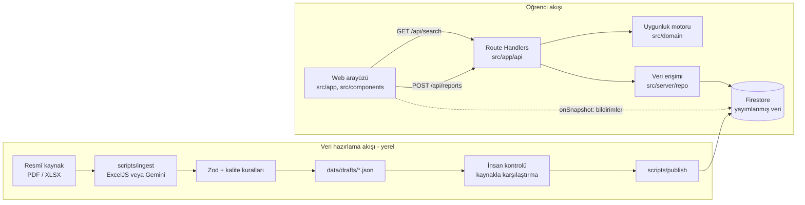

# ARCHITECTURE.md

Amaç: Mimariyi, veri modelini, veri hazırlama hattını, güvenliği ve dağıtımı tek yerde sabitlemek.
Sürüm numaraları bilerek sabitlenmedi: kurulumda `create-next-app@latest` ve paketlerin güncel kararlı
sürümleri kullanılır, uyumluluk kurulum anında resmî dokümanlardan kontrol edilir.

## 1. Teknoloji kararları

| Konu | Seçim | Gerekçe | Alternatif | Temel risk |
|---|---|---|---|---|
| Uygulama | Next.js (App Router) + TypeScript, modüler monolit | Arayüz ve sunucu uçları tek kod tabanında; gizli anahtar sunucuda kalır | Vite + Cloud Functions (iki ayrı dağıtım) | App Router öğrenme eğrisi; Server/Client sınırı |
| Stil | Tailwind CSS | Hızlı, mobil öncelikli | shadcn/ui (yalnızca gerekirse) | Yok denecek kadar az |
| Veritabanı | Cloud Firestore | Gerçek zamanlı dinleme, sıfır sunucu yönetimi | Supabase | Sorgu/indeks tasarımı |
| Kimlik | Firebase Anonymous Auth | Kayıt yok; yine de hız sınırı için kullanıcı kimliği | SAÜ e-posta girişi (sonraya) | Anonim hesap çoğaltma |
| Yazma güvenliği | Route Handler + Firebase Admin SDK + Zod | Tüm yazmalar tek noktada doğrulanır | İstemci yazma + Security Rules | Admin SDK kuralları atlar; doğrulama kodda olmalı |
| AI | Gemini API (yapılandırılmış JSON çıktısı) | PDF'i doğrudan okur, şemaya uygun çıktı verir | Yalnızca deterministik ayrıştırma | Uydurma değer; mutlaka doğrulanır |
| XLSX | ExcelJS (bakım ve lisans kurulumda kontrol edilir) | XLSX'te AI'ya gerek yok, deterministik | SheetJS | Birleştirilmiş hücreler |
| Test | Vitest (zorunlu), Playwright (tek uçtan uca akış, zaman kalırsa) | Uygunluk motoru saf TS, hızlı test | Jest | — |
| Yerel geliştirme | Firebase Emulator Suite (Firestore + Auth) | Gerçek projeye dokunmadan test | Ayrı dev projesi | Kurulum süresi |
| Dağıtım | Plan A: Firebase App Hosting · Plan B: Vercel | App Hosting Next.js'i destekler, Blaze planı ister (doğrulanmalı) | Firebase Hosting + statik dışa aktarım | Derleme süresi, faturalandırma |

Mikroservis yok: tek uygulama, tek veritabanı, ayrı çalışan yerel bir veri hazırlama betiği.

## 2. Bileşenler ve akışlar



Kurallar:
- Uygunluk motoru saf fonksiyonlardan oluşur; Firestore'u, saati ya da React'i bilmez. "Şimdi" parametre olarak gelir.
- Gemini yalnızca veri hazırlama akışındadır. Öğrenci araması Gemini'ye hiç dokunmaz.
- Taslaklar Firestore'a değil yerel `data/drafts/` klasörüne yazılır; Firestore'da yalnızca yayımlanmış veri vardır.

## 3. Klasör yapısı

```
/
├─ CLAUDE.md
├─ docs/                      ürün ve teknik belgeler
├─ src/
│  ├─ data/map-layout.ts      SVG şema koordinatları (ekip çizimi)
│  ├─ app/                    sayfalar ve API uçları (iş kuralı yok)
│  │  ├─ page.tsx             süre seçimi
│  │  ├─ results/page.tsx     sonuç listesi
│  │  ├─ spaces/[id]/page.tsx alan ayrıntısı + bildirim + değerlendirme
│  │  ├─ map/page.tsx         SVG kampüs/bina şeması
│  │  └─ api/
│  │     ├─ search/route.ts   GET: uygunluk sonuçları
│  │     ├─ reports/route.ts  POST: bildirim / check-in (Zod + hız sınırı)
│  │     └─ ratings/route.ts  POST: değerlendirme (Zod + check-in kontrolü + hız sınırı)
│  ├─ components/             sunum bileşenleri (Firestore veya kural kodu yok)
│  ├─ domain/                 saf TS: tipler, uygunluk, güven, sıralama (Firebase importu yasak)
│  ├─ server/                 Admin SDK, repo fonksiyonları, hız sınırı (istemciye girmez: "server-only")
│  └─ lib/                    istemci Firebase başlatma, saat/biçim yardımcıları
├─ scripts/
│  ├─ ingest/                 PDF/XLSX → taslak JSON (Gemini burada)
│  ├─ publish.ts              onaylı taslak → Firestore
│  └─ seed-demo.ts            demo binası + etiketli simülasyon
├─ data/
│  ├─ sources/                indirilen kaynak dosyalar (gitignore değil, küçük)
│  └─ drafts/                 ayrıştırma çıktıları
├─ tests/
│  ├─ domain/                 Vitest birim testleri
│  ├─ ingest/                 ayrıştırma testleri (sabit örnek dosyalarla)
│  └─ e2e/                    Playwright (zaman kalırsa)
├─ firestore.rules
├─ firestore.indexes.json
└─ .env.example
```

## 4. Veri modeli (Firestore)

Zaman alanları: `weekday` 1-7 (Pazartesi=1), `startMinute`/`endMinute` gece yarısından itibaren dakika, saat dilimi Europe/Istanbul.
Zaman damgaları Firestore `Timestamp`.

### `terms/{termId}`
```json
{ "id": "2026-guz", "label": "2026-2027 Güz", "startsOn": "2026-09-21", "endsOn": "2027-01-15", "isActive": true }
```
Tek aktif dönem. Dönem değişince eski dönemin `isActive=false` olur; motor yalnızca aktif dönemin bloklarını okur.

### `buildings/{buildingId}`
```json
{ "id": "isletme-a", "name": "İşletme Fakültesi A Blok", "campus": "Esentepe", "isSimulated": false }
```

### `spaces/{spaceId}`
```json
{
  "id": "isletme-a-A204", "buildingId": "isletme-a", "code": "A204",
  "kind": "CLASSROOM",              // CLASSROOM | LIBRARY | STUDY_AREA
  "accessStatus": "UNKNOWN",        // OPEN | RESTRICTED | UNKNOWN
  "dataQuality": "OK",              // OK | INCOMPLETE (varsayılan OK)
  "isSimulated": false
}
```

### `scheduleSources/{sourceId}`
```json
{
  "id": "isletme-2026-guz-v1", "termId": "2026-guz", "department": "İşletme",
  "url": "https://...", "format": "PDF",           // PDF | XLSX
  "fetchedAt": "2026-10-27T18:30:00+03:00", "sha256": "…",
  "parseMethod": "GEMINI",                          // GEMINI | DETERMINISTIC | MANUAL
  "status": "PUBLISHED",                            // PUBLISHED | SUPERSEDED
  "blockCount": 84, "flaggedCount": 3, "reviewedBy": "ekip"
}
```
Yeni sürüm yayımlanınca eskisi `SUPERSEDED` olur; motor yalnızca `PUBLISHED` kaynakların bloklarını kullanır.

### `scheduleBlocks/{blockId}`
```json
{
  "termId": "2026-guz", "sourceId": "isletme-2026-guz-v1", "sourceStatus": "PUBLISHED",
  "spaceId": "isletme-a-A204", "weekday": 2, "startMinute": 660, "endMinute": 780,
  "courseCode": "UTC425", "courseName": "Kültürlerarası Pazarlama",
  "sourceRef": "s.2, satır 14"
}
```
Sorgular: bir günün programı → `termId == X AND sourceStatus == PUBLISHED AND weekday == D`;
bir odanın programı → `spaceId == S AND weekday == D`. Her ikisi için bileşik indeks `firestore.indexes.json`'a eklenir.
Veri küçük (tek bina, ~100 blok) olduğu için motor bir günün tüm bloklarını tek sorguda okur ve bellekte hesaplar.

### `spaceReports/{reportId}`
```json
{ "spaceId": "isletme-a-A204", "type": "AVAILABLE", "uid": "<anon uid>", "createdAt": "<Timestamp>", "isSimulated": false }
```
`type`: AVAILABLE | BUSY | UNUSABLE | OUTDATED. `AVAILABLE` aynı zamanda check-in'dir.
Sorgu: `spaceId == S AND createdAt >= now-REPORT_TTL_MIN` (30 dk), `createdAt` azalan.
Saklama: 7 gün (demo sonrası temizlik betiği; hackathon içinde silme yok).

### `spaceRatings/{ratingId}`
```json
{
  "spaceId": "isletme-a-A204", "uid": "<anon uid>", "checkinReportId": "<spaceReports id>",
  "scores": { "quiet": 4, "power": 2, "wifi": 5, "light": 3 },   // her biri 1-5 tam sayı
  "createdAt": "<Timestamp>", "isSimulated": false
}
```
Yazma koşulu `src/domain/ratings.ts` `canRate` ile (bkz. AVAILABILITY_RULES §4). Sorgu: `spaceId == S`.
Serbest metin alanı yoktur.

### `simulations/library`
```json
{ "spaceId": "kutuphane-merkez", "level": "BUSY", "updatedAt": "<Timestamp>", "isSimulated": true }
```
Yalnızca `DEMO_MODE=true` iken yazılır ve okunur.

`spaceStatus` koleksiyonu kullanılmıyor: durum her istekte son bildirimlerden hesaplanır; veri küçük, önbellek gereksiz.

## 5. Veri hazırlama hattı

1. Kaynak kaydı: dosya `data/sources/` içine indirilir, SHA-256 hesaplanır, `termId` ve bölüm elle girilir.
2. Biçime göre ayrıştırma:
   - XLSX → ExcelJS ile deterministik. Birleştirilmiş hücreler üst-sol değerle doldurulur; sütun adları eşleme tablosuyla normalize edilir; her sayfa ayrı işlenir.
   - Metin tabanlı ve düzenli PDF → önce metin çıkarımı denenir; düzen tutarlıysa deterministik.
   - Düzensiz PDF → Gemini'ye belge + JSON şeması gönderilir.
3. Gemini kuralları: çıktı şeması zorunlu; her satır için `sourceRef` (sayfa/satır) ister; okuyamadığı alan `null` döner ve
   `needsReview=true` olur. İstem: "Belgede açıkça yazmayan hiçbir değeri üretme."
4. Doğrulama (Zod + kurallar), her ihlal kaydı `needsReview=true` yapar:
   - oda kodu boş veya oda listesinde yok · başlangıç/bitiş eksik · `startMinute >= endMinute` · gün geçersiz
   - aynı oda ve gün içinde çakışan iki ders · tekrar eden satır · dönem `termId` ile uyuşmuyor
   - model çıktısındaki ders kodu belgenin metninde geçmiyor (metin çıkarılabiliyorsa karşılaştırılır)
5. İnsan kontrolü: `needsReview` kayıtlar ve rastgele 10 kayıt kaynak belgeyle elle karşılaştırılır.
6. Yayın: yalnızca `needsReview=false` kayıtlar yüklenir; kaynak `PUBLISHED`, önceki sürüm `SUPERSEDED`.

Eski dönem PDF'leri yalnızca ayrıştırıcı testlerinde kullanılır, asla yayımlanmaz.

## 6. Güvenlik ve gizlilik

- Kişisel veri yok: e-posta, kart numarası, konum saklanmaz. Bildirimde yalnızca anonim `uid` tutulur.
- `GEMINI_API_KEY` yalnızca geliştiricinin `.env.local` dosyasında ve betiklerde. Web uygulamasının ortamına konmaz.
- `FIREBASE_SERVICE_ACCOUNT` yalnızca sunucuda. İstemcide sadece `NEXT_PUBLIC_FIREBASE_*` yapılandırması.
- `firestore.rules`: herkes `terms`, `buildings`, `spaces`, `scheduleBlocks`, `spaceReports` okuyabilir; istemciden hiçbir koleksiyona yazma yok.
  Açık not (Aşama 6'da karar): `spaceReports`/`spaceRatings` anonim `uid` içerir; istemciye doğrudan açmak yerine
  API üzerinden uid'siz okunması veya uid'nin hash'lenmesi değerlendirilecek.
  Admin SDK kuralları atladığı için tüm yazma doğrulaması `src/server` içinde yapılır.
- Bildirim kötüye kullanımı: aynı `uid` + oda için 10 dakikada 1 bildirim; `uid` başına saatte 20 bildirim; Zod ile tip kontrolü.
- Değerlendirme: yalnızca check-in sonrası, check-in başına 1 puan; `uid` başına saatte 10 değerlendirme.
  İstek anonim ID token'ı ile gelir, sunucuda doğrulanır.
- App Check: sonraya bırakıldı (kurulum süresi; demo için hız sınırı yeterli).
- KVKK uyumluluğu hakkında garanti verilmez; sunumda "kişisel veri toplamıyoruz" denir, fazlası değil.

## 7. Dağıtım ve ortamlar

- Ortamlar: yerel (Emulator), demo (tek Firebase projesi). Ayrı üretim yok.
- `.env.example`: `NEXT_PUBLIC_FIREBASE_*`, `FIREBASE_SERVICE_ACCOUNT`, `GEMINI_API_KEY` (yalnızca betikler), `DEMO_MODE`.
- Demo verisi ayrımı: `isSimulated` alanı + `DEMO_MODE` bayrağı. `seed-demo` yalnızca `DEMO_MODE=true` iken çalışır.
- Geri dönüş: hatalı yayında `publish --rollback <sourceId>` önceki `SUPERSEDED` kaynağı yeniden `PUBLISHED` yapar.
- Erken deneme: ilk iskelet hemen dağıtılır; dağıtım son saate bırakılmaz.
