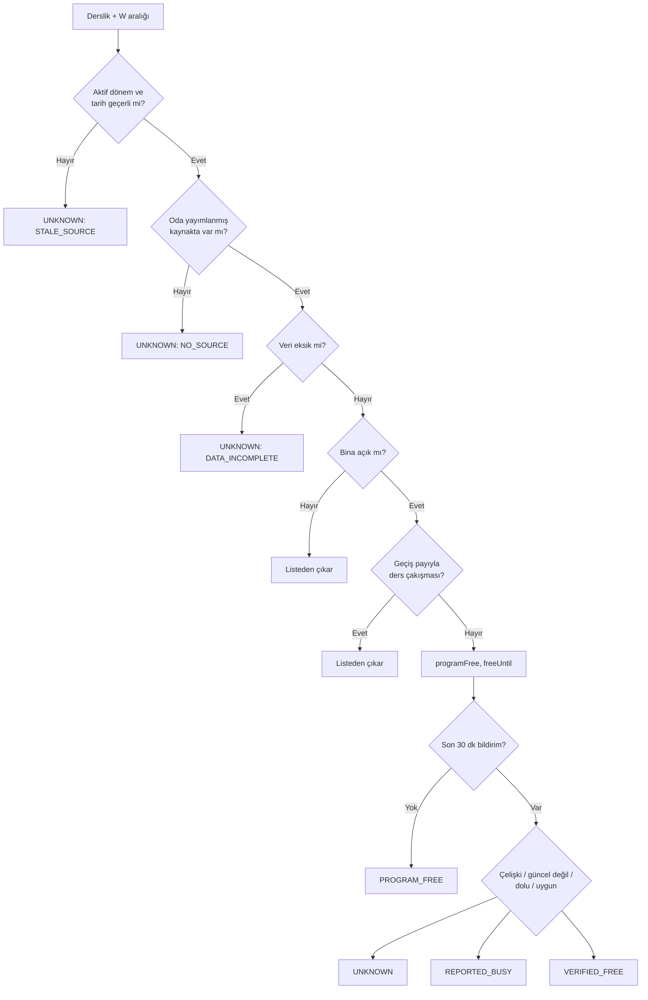

# AVAILABILITY_RULES.md

Amaç: Uygunluk motorunu ve güven kurallarını doğrudan koda ve teste aktarılabilecek kesinlikte tanımlamak.
Kod yeri: `src/domain/availability.ts`, `src/domain/trust.ts`, `src/domain/ranking.ts`. Testler: `tests/domain/`.

## Yapılandırma (`src/domain/config.ts`)

| Ad | Varsayılan | Not |
|---|---|---|
| `BUFFER_MIN` | 10 | Ders öncesi/sonrası geçiş payı. Hipotez, doğrulanmış SAÜ kuralı değil |
| `OPEN_MINUTE` / `CLOSE_MINUTE` | 480 / 1320 (08.00-22.00) | Bina saatleri hipotezi; bina bazında değiştirilebilir |
| `REPORT_TTL_MIN` | 30 | Bu süreden eski bildirim dikkate alınmaz |
| `NEGATIVE_TTL_MIN` | 20 | "Dolu / Kullanılamıyor" bildiriminin etkili kaldığı süre |
| `CONFLICT_WINDOW_MIN` | 10 | Bu aralıktaki zıt bildirimler çelişki sayılır |
| `RATING_WINDOW_MIN` | 180 | Check-in'den sonra değerlendirme yapılabilecek süre |
| `MIN_RATINGS_TO_SHOW` | 3 | Bu sayının altında ortalama gösterilmez |

## Girdiler
`now` (Europe/Istanbul tarih-saat; motor saati kendisi okumaz), `durationMin` ∈ {30, 60, 90, 120},
aktif dönem, o günün yayımlanmış blokları, aday alanlar, son 30 dakikanın bildirimleri.

## Durum etiketleri (tek kaynak: `src/domain/types.ts`)

| Kod | Arayüz metni | Anlamı |
|---|---|---|
| `VERIFIED_FREE` | Öğrenci doğruladı | Programda boş + son 30 dk içinde "uygun" bildirimi, son 20 dk içinde daha yeni olumsuz bildirim yok |
| `PROGRAM_FREE` | Programda boş | Programa göre aralıkta ders yok; gerçek durum bilinmiyor |
| `UNKNOWN` | Durum bilinmiyor | Veri eksik, eski veya çelişkili (`reason` ile birlikte) |
| `REPORTED_BUSY` | Dolu bildirildi | Son 20 dk içinde dolu/kullanılamaz bildirimi |

`UNKNOWN` nedenleri: `NO_SOURCE`, `STALE_SOURCE`, `DATA_INCOMPLETE`, `CONFLICTING_REPORTS`, `REPORTED_OUTDATED`, `PARTIAL_SOURCE`.
Arayüz yüzde veya olasılık göstermez. Renk tek başına anlam taşımaz; her etiket metinle yazılır.

## 1. Program kontrolü (her derslik için)

```
W = [nowMin, nowMin + durationMin]
0. W.start < OPEN_MINUTE veya W.end > CLOSE_MINUTE ise       → sonuçlardan çıkar (bina kapalı)
1. Aktif dönem yoksa veya now dönem tarihleri dışındaysa     → UNKNOWN(STALE_SOURCE)
2. Oda hiçbir PUBLISHED kaynakta (tam veya kısmi) geçmiyorsa → UNKNOWN(NO_SOURCE)
3. Oda dataQuality = INCOMPLETE ise                          → UNKNOWN(DATA_INCOMPLETE)
5. Bugünkü herhangi bir blok b için
     b.start - BUFFER < W.end  VE  b.end + BUFFER > W.start  → sonuçlardan çıkar (ders var)
6. Oda yalnızca kısmi kaynakta (coverage=PARTIAL) geçiyorsa → PARTIAL (freeUntil/nextClass bilinen derslere göre)
7. Aksi halde programFree = true
     freeUntil = (now'dan sonra başlayan ilk bloğun start'ı) - BUFFER, yoksa CLOSE_MINUTE
     nextClass = o blok (ders kodu + saat) veya null
```

Notlar:
- Aralıklar yarı açıktır: `[start, end)`. Biten bir ders + 10 dk payın tam sonunda başlayan aralık çakışmaz.
- Gün aşımı: `W.end > 1440` adım 0 ile zaten elenir (kapanış 22.00).
- Bina saati kontrolü en baştadır: bina kapalıyken veri eksik odalar da listelenmez (T7b).
- Dönem tarihleri dahildir: `startsOn <= bugün <= endsOn` (Europe/Istanbul takvim günü).
- `UNKNOWN` odalarda `freeUntil = null`; bu odalar güven değerlendirmesine girmez.
- Kısmi kaynak (ör. ekibin kişisel programları) yalnızca bazı dersleri bilir: bilinen ders çakışması odayı eler,
  ama çakışma yokluğu "boş" anlamına gelmez. Aynı oda tam kaynakta da varsa tam kaynak geçerlidir.
- `weekday`: Pazartesi=1 … Pazar=7 (JS `getDay()` Pazar=0 döndürür; dönüşüm `src/domain/time.ts`).
- Çakışan iki blok yayımlanmaz (veri hazırlamada elenir); yine de motor ikisini de dikkate alır.

## 2. Güven değerlendirmesi (programFree olan derslikler ve kütüphane için)

```
base = derslik için PROGRAM_FREE, kısmi kaynaklı oda için UNKNOWN(PARTIAL_SOURCE), kütüphane için UNKNOWN(NO_SOURCE)
R = son REPORT_TTL_MIN dakikadaki bildirimler, yeniden eskiye
1. R boşsa                                            → base
2. En yeni bildirim OUTDATED ise                      → UNKNOWN(REPORTED_OUTDATED)
3. neg = son NEGATIVE_TTL_MIN içindeki en yeni BUSY/UNUSABLE
   pos = R içindeki en yeni AVAILABLE
4. neg ve pos var, farklı uid, aralarındaki fark ≤ CONFLICT_WINDOW_MIN → UNKNOWN(CONFLICTING_REPORTS)
5. neg var ve (pos yok veya neg daha yeni)            → REPORTED_BUSY
6. pos var                                            → VERIFIED_FREE (kaç dk önce, kaç bildirim)
7. Aksi halde                                         → base
```

Kararı veren bildirim örnek (`isSimulated`) ise sonuç `simulated: true` taşır ve "Örnek demo verisi" etiketiyle gösterilir;
`DEMO_MODE` kapalıyken örnek bildirimler hiç hesaba katılmaz.

`accessStatus = UNKNOWN` etiketi değiştirmez; kartta "Erişim durumu doğrulanmadı" notu çıkar.

Kütüphane: ders programı yoktur, program kontrolü atlanır; base = `UNKNOWN(NO_SOURCE)`, metin "Doluluk verisi yok".
Böylece süresi dolmuş tek bir olumsuz bildirim kütüphaneyi asla "Programda boş" göstermez.
`DEMO_MODE` açıksa simülasyon seviyesi ayrı alan olarak, "Örnek demo verisi" etiketiyle gösterilir; etiketi değiştirmez.

## 3. Sıralama

1. Etiket önceliği: `VERIFIED_FREE` > `PROGRAM_FREE` > `UNKNOWN` > `REPORTED_BUSY`
2. Aynı etikette: `freeUntil` büyük olan önce (daha uzun boş kalan)
3. Eşitlikte: oda kodu alfabetik
4. Aynı etiket ve `freeUntil = null` olanlar en sonda
Kütüphane her zaman listenin en üstünde ayrı kart olarak durur, sıralamaya girmez.
Değerlendirme puanları sıralamayı etkilemez.

## 4. Değerlendirme kuralları (`src/domain/ratings.ts`)

- Check-in = aynı `uid`'nin o alana yaptığı `AVAILABLE` bildirimi.
- `canRate(uid, spaceId, now)`: son `RATING_WINDOW_MIN` (180) dk içinde bu uid'nin bu alanda check-in'i var
  VE o check-in için daha önce değerlendirme yapılmamış. Değerlendirme en yeni uygun check-in'e bağlanır.
- Puanlar: `quiet`, `power`, `wifi`, `light` — her biri 1-5 tam sayı, dördü de zorunlu. Serbest metin yok.
- `aggregateRatings`: kriter başına ortalama (bir ondalık) ve toplam sayı. Sayı < `MIN_RATINGS_TO_SHOW` (3) ise
  ortalama yerine "Henüz yeterli değerlendirme yok".
- Simüle değerlendirmeler `isSimulated: true` taşır, ortalamaya ayrı gösterilir ve "Örnek demo verisi" etiketlidir.
- Puanlar uygunluk etiketini değiştirmez.

## Akış



## Test senaryoları (Vitest, hackathon içinde zorunlu)

Tüm örneklerde gün Salı (2), `BUFFER_MIN = 10`, kapanış 22.00.

| # | Durum | Beklenen |
|---|---|---|
| T1 | Saat 13.00, 60 dk, odada ders yok | `PROGRAM_FREE`, `freeUntil = 1320` (kapanış, 22.00) |
| T2 | Saat 13.00, 60 dk, ders 13.30'da başlıyor | Listeden çıkar |
| T3 | Saat 13.00, 60 dk, ders 14.10'da başlıyor | Uygun; `freeUntil = 14.00` (840) |
| T4 | Saat 13.00, 60 dk, ders 14.05'te başlıyor | Listeden çıkar (pay 13.55'e taşar) |
| T5 | Saat 13.05, 30 dk, ders 11.00-13.00 bitti | Listeden çıkar (13.10'a kadar pay) |
| T6 | Saat 13.10, 30 dk, ders 11.00-13.00 bitti | Uygun (yarı açık aralık sınırı) |
| T7 | Saat 21.30, 60 dk | Listeden çıkar (kapanış) |
| T7b | Saat 21.30, 60 dk, oda `dataQuality = INCOMPLETE` | Listeden çıkar (bina saati önce gelir) |
| T8 | Oda hiçbir yayımlanmış kaynakta yok | `UNKNOWN(NO_SOURCE)` |
| T9 | Aktif dönem bitmiş (now > endsOn) | `UNKNOWN(STALE_SOURCE)` |
| T10 | Oda `dataQuality = INCOMPLETE` | `UNKNOWN(DATA_INCOMPLETE)` |
| T11 | Programda boş, 5 dk önce AVAILABLE | `VERIFIED_FREE` |
| T12 | Programda boş, 40 dk önce AVAILABLE | `PROGRAM_FREE` (bildirim süresi doldu) |
| T13 | 8 dk önce AVAILABLE, 3 dk önce BUSY, farklı uid | `UNKNOWN(CONFLICTING_REPORTS)` |
| T14 | 25 dk önce AVAILABLE, 5 dk önce BUSY | `REPORTED_BUSY` |
| T15 | 25 dk önce BUSY (negatif süresi doldu), bildirim başka yok | `PROGRAM_FREE` |
| T16 | En yeni bildirim OUTDATED | `UNKNOWN(REPORTED_OUTDATED)` |
| T17 | Sıralama: VERIFIED (freeUntil 15.00), PROGRAM (17.00), PROGRAM (16.00), BUSY | VERIFIED, PROGRAM 17.00, PROGRAM 16.00, BUSY |
| T-L1 | Kütüphane, bildirim yok | `UNKNOWN(NO_SOURCE)` ("Doluluk verisi yok") |
| T-L2 | Kütüphane, yalnızca 25 dk önce BUSY | `UNKNOWN(NO_SOURCE)` (asla `PROGRAM_FREE` değil) |
| T18 | Aynı uid aynı odaya 4 dk arayla iki bildirim | İkincisi hız sınırıyla reddedilir (`src/server` testi) |
| T24 | Kısmi kaynak, 13.00, 60 dk, bilinen ders 15.10 | PARTIAL, `freeUntil = 15.00` |
| T25 | Kısmi kaynak, bilinen ders 13.30 | Listeden çıkar |
| T26 | Kısmi kaynak, bildirim yok / yalnızca 25 dk önce BUSY | `UNKNOWN(PARTIAL_SOURCE)` (asla `PROGRAM_FREE` değil) |
| T27 | Kısmi kaynak, 3 dk önce AVAILABLE / BUSY | `VERIFIED_FREE` / `REPORTED_BUSY` |
| T19 | Check-in yokken değerlendirme | Reddedilir |
| T20 | Check-in 190 dk önce | Reddedilir (süre doldu) |
| T21 | Aynı check-in'e ikinci değerlendirme | Reddedilir |
| T22 | 2 değerlendirme / 3 değerlendirme | "Henüz yeterli değerlendirme yok" / kriter ortalamaları |
| T23 | Yüksek puanlı PROGRAM_FREE oda ile VERIFIED_FREE oda | Sıralama değişmez: VERIFIED önce |
